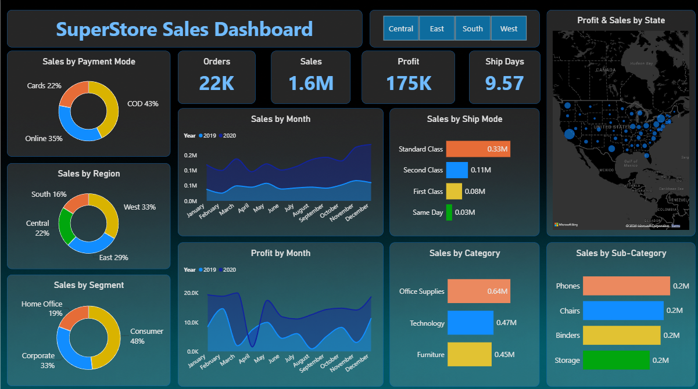
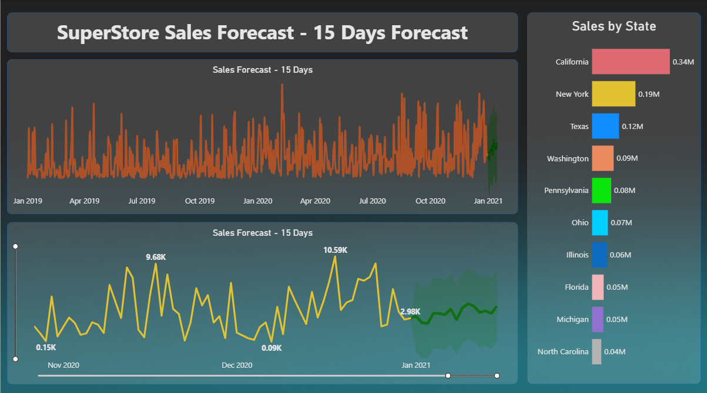

# SuperStore Sales Analysis & Forecasting Dashboard

An interactive sales analytics dashboard built using **Microsoft Power BI** to explore sales performance, profitability, regional trends, customer segments, and shipping operations. The project also includes a 15-day sales forecast.

## Project Objectives

- Track key performance indicators (KPIs) for sales, orders, profit, and delivery duration.
- Analyze sales across regions, customer segments, payment modes, shipping modes, product categories, and sub-categories.
- Compare monthly sales and profit trends across years.
- Visualize state-level sales and profit geographically.
- Explore historical sales patterns and a 15-day forecast.

## Dashboard Preview

### Sales Dashboard

### Sales Forecast

## Key Features

- **KPI Cards:** Total Sales, Orders, Profit, and Average Shipping Days.
- **Sales Analysis:** Breakdown by payment mode, region, segment, category, and sub-category.
- **Trend Analysis:** Monthly sales and profit comparisons by year.
- **Shipping Analysis:** Sales by shipping mode and average delivery duration.
- **Geographic Analysis:** State-level sales and profit visualization.
- **Interactive Filtering:** Regional slicers to explore performance across regions.
- **Sales Forecasting:** A separate report page displaying historical sales and a 15-day forecast.

## Tools & Technologies

- Microsoft Power BI Desktop
- DAX (Data Analysis Expressions)
- Data visualization and time-series analysis

## Key Metrics

The current dashboard displays approximately:

| Metric | Value |
|---|---:|
| Total Sales | 1.57M |
| Orders | 22K |
| Total Profit | 175.26K |
| Average Shipping Days | 9.57 |

*Values may vary depending on report filters.*

## Data Quality Considerations

Delivery duration is calculated from order and ship dates. Negative durations and unusually long shipping times should be validated against the source data before drawing business conclusions.

## How to Use

1. Download `SuperStore_Sales_Dashboard.pbix` from this repository.
2. Open the file in Microsoft Power BI Desktop.
3. Navigate between the report pages and interact with the regional filters to explore the data.

## Dataset Attribution

Add the original dataset source or the relevant tutorial link here before publishing the final project documentation. Dataset redistribution terms should be checked before sharing the raw data.

## Disclaimer

This project is intended for learning and portfolio demonstration. Forecast reliability depends on the underlying data and forecasting method; the forecast should not be interpreted as a guarantee of future sales.
